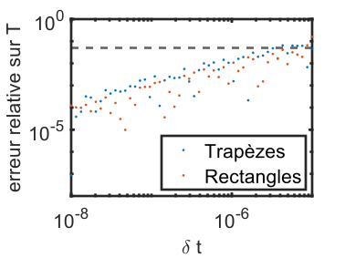
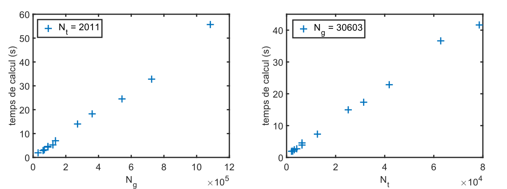
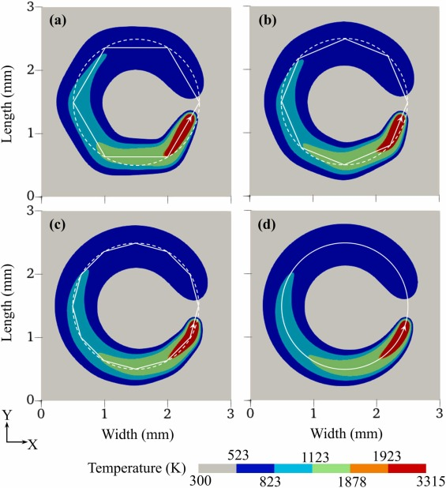
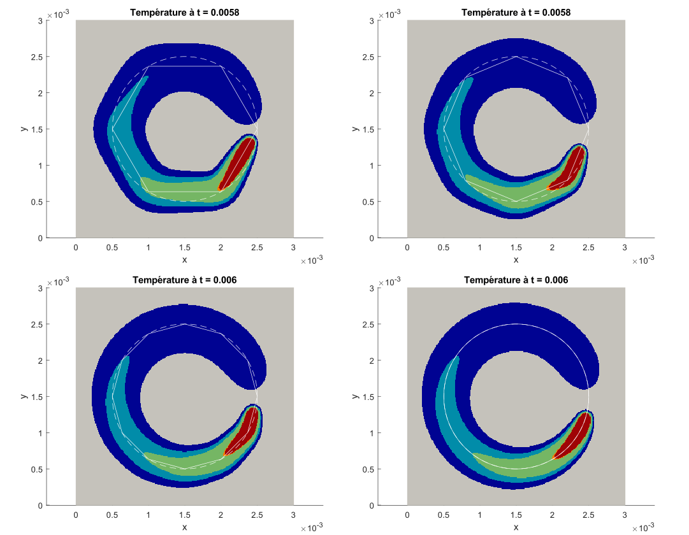
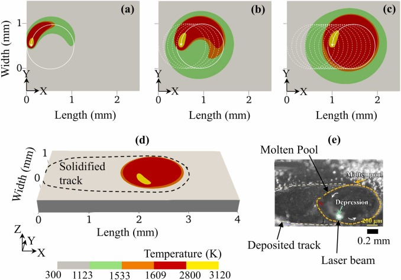
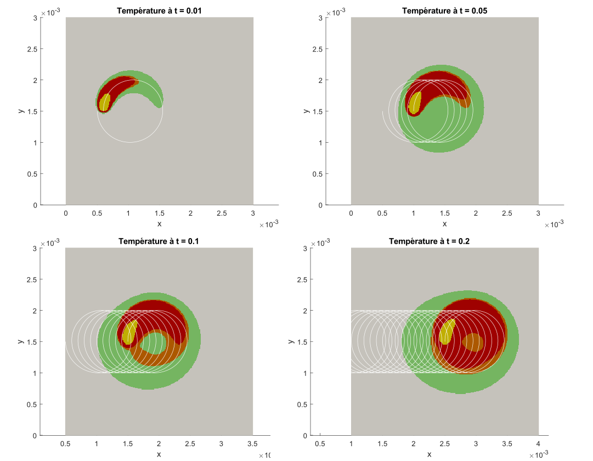

# Rapport

## Sommaire

1. [Introduction](#introduction)
2. [Description du modèle](#description-du-modèle)
3. [Description du code](#description-du-code)
   * [Définition des paramètres](#définition-des-paramètres)
   * [Calcul de la position du laser](#calcul-de-la-position-du-laser)
   * [Calcul de la température](#calcul-de-la-température)
   * [Affichage](#affichage)
   * [Complexité algorithmique](#complexité-algorithmique)
4. [Utilisation du code et résultats](#utilisation-du-code-et-résultats)
   * [Reproduction de la figure 4](#reproduction-de-la-figure-4)
   * [Reproduction de la figure 6](#reproduction-de-la-figure-6)
5. [Discussion](#discussion)
6. [Conclusion](#conclusion)
7. [Références](#références)

## Introduction

Dans un contexte de fort développement de la fabrication additive métallique, la fusion sur lit de poudre se révèle être une technologie prometteuse. Par exemple, elle permet d'obtenir des pièces de géométrie complexe sans concevoir de processus de fabrication spécifique. Cependant, certains défis restent à relever comme celui des contraintes résiduelles qui diminuent la tenue mécanique des pièces fabriquées.

Il est connu que des contraintes internes apparaissent lors de la fabrication en raison des fortes variations de température lors du passage du spot laser. Pour comprendre ce phénomène, on doit s'intéresser à la manière dont la chaleur se diffuse dans la pièce.
Dans ce document, on détaille une méthode de calcul de la température qui a été utilisée pour tester et optimiser différentes stratégies de scan afin de limiter l'apparition de contraintes internes.

## Description du modèle

Le modèle étudié est proposé par \[Zagade et al, 2021\]. Il se place à l'échelle du cordon et est conçu pour être rapide à exécuter. De fortes hypothèses ont donc été faites pour alléger les calculs.

* La pièce est supposée de très grandes dimensions. Les effets de bord vis-à-vis de la thermique sont négligés.
* L'effet d'isolation thermique de la poudre est négligé.
* La chaleur latente de fusion du matériau est négligée, de même pour les transformations de phase.
* Convection négligée à l'intérieur du bain de fusion et à l'interface avec l'air.
* Transferts de chaleur par rayonnement négligés.
* La conductivité et la chaleur spécifique des matériaux est supposée évoluer linéairement avec la température : $C, k \propto (1 + mT)$
* La puissance fournie par le laser est constante au cours du temps et est répartie selon une gaussienne à l'intérieur du spot.

Après résolution de l'équation de la chaleur, on trouve que le champ de température peut être calculé analytiquement avec la formule suivante. $(A, B_1, B_2, C_1, C_2)$ sont des constantes relatives au matériau et au laser, $\tau'\prime = B_1 \mathrm{t}^{\prime} \prime + B_2 \sqrt{C_1 \mathrm{t}^{\prime} \prime + C_2}$ et $\mathrm{t}^{\prime} \prime = t - t'$
<!--
$`\mathrm{T}(\mathrm{x}, \mathrm{y}, \mathrm{z}, \mathrm{t})=\frac{1}{\mathrm{~m}} \times\left[\left(2 \mathrm{~m} \int_{\mathrm{t}^{\prime}=0}^{\mathrm{t}^{\prime}=\mathrm{t}} \frac{2 \mathrm{f}_{\mathrm{p}} \eta \mathrm{P} \sqrt{\mathrm{f}_{\mathrm{d}}}}{\rho \mathrm{C}_0 \pi \sqrt{\pi}} \frac{1}{\tau^{\prime} \prime} \exp \left\{-\frac{\mathrm{f}_{\mathrm{p}}\left\{\left(\mathrm{x}^{\prime} \prime\right)^2+\left(\mathrm{y}^{\prime} \prime\right)^2\right\}}{4 \mathrm{f}_{\mathrm{p}} \alpha \mathrm{t}^{\prime} \prime+\mathrm{r}_{\mathrm{b}}^2}-\frac{\mathrm{f}_{\mathrm{d}}(\mathrm{z})^2}{4 \mathrm{f}_{\mathrm{d}} \alpha \mathrm{t}^{\prime} \prime+\mathrm{h}^2}\right\} \mathrm{dt}^{\prime}+\left(1+\mathrm{mT}_0\right)^2\right)^{\frac{1}{2}}-1\right]`$ -->

$`\mathrm{T}(\mathrm{x}, \mathrm{y}, \mathrm{z}, \mathrm{t})=\frac{1}{\mathrm{~m}}\left[\left(2 \mathrm{~m} \int_{0}^{\mathrm{t}} \frac{A}{\tau^{\prime} \prime} \exp \left\{-\frac{\mathrm{f}_{\mathrm{p}}d_\text{laser}^2}{B_1 \mathrm{t}^{\prime} \prime + B_2}-\frac{\mathrm{f}_{\mathrm{d}}\mathrm{z}^2}{C_1 \mathrm{t}^{\prime} \prime+C_2}\right\} \mathrm{dt}^{\prime}+\left(1+\mathrm{mT}_0\right)^2\right)^{\frac{1}{2}}-1\right]`$

La chaleur apportée a une forme de gaussienne donc chaque point reçoit une énergie en fonction du carré de sa distance au spot laser $d_\text{laser}$. La dissipation de cette énergie est principalement due à la conduction dans la pièce, qui est modélisée par une dépendance de la hauteur et de l'écart type de la gaussienne en $\mathrm{t}^{\prime} \prime$, qui représente le temps écoulé depuis le passage du laser à cet endroit-là. L'apport d'énergie s'atténue également au fur et à mesure que l'on s'éloigne de la surface supérieure de la pièce (située en $z=0$).

## Description du code

L'enjeu du projet est de calculer cette équation à chaque point de l'espace et à chaque instant. Les principales difficultés sont la grande quantité de données à traiter et le calcul numérique de l'intégrale.

Le code s'organise en 4 parties : définition des paramètres, calcul de la position du laser, calcul de la température et affichage.

### Définition des paramètres

Ici, tous les paramètres du calcul sont définis. On a :

* des paramètres relatifs à l'affichage
* la discrétisation de l'espace et du temps
* la trajectoire, vitesse et puissance du laser
* les paramètres matériau

### Calcul de la position du laser

La trajectoire laser est initialement un ensemble de points potentiellement éloignés entre lesquels le laser se déplace linéairement. On doit interpoler cette trajectoire pour obtenir la position du spot laser à chaque instant du vecteur temps. Dans le cas où la trajectoire programmée est terminée avant la fin de la simulation, le vecteur temps est tronqué.

### Calcul de la température

L'essentiel de cette partie consiste à calculer l'intégrale suivante à chaque point de l'espace-temps de manière la plus efficace possible.  
$`\int_0^t f(t')dt' = \int_{0}^{\mathrm{t}} \frac{A}{\tau^{\prime} \prime} \exp \left\{-\frac{\mathrm{f}_{\mathrm{p}}d_\text{laser}^2}{B_1 \mathrm{t}^{\prime} \prime + B_2}-\frac{\mathrm{f}_{\mathrm{d}}\mathrm{z}^2}{C_1 \mathrm{t}^{\prime} \prime+C_2}\right\} \mathrm{dt}^{\prime}`$

Pour calculer $f$ à un instant $t$ pour chaque point de l'espace, une grille 3D de la zone de calcul est créée avec la discrétisation en espace choisie par l'utilisateur. A chaque instant $t$, on connait la position du spot laser grâce au travail effectué précédemment et on en déduit le champ de distance au laser $d_\text{laser}$. De même, le champ de coordonnée $z$ est facilement obtenu. Les calculs sont effectués sur ces grilles 3D pour obtenir directement $f$ en chaque point de l'espace, ce qui évite d'imbriquer de nombreuses boucles qui ralentiraient les calculs.

Maintenant que $f$ est obtenu, on calcule son intégrale avec la méthode des rectangles. On évalue $f$ à chaque point d'un vecteur temps entre 0 et $t$ et on calcule la somme multipliée par le pas du vecteur temps $\delta t$.

Une étude a été réalisée pour obtenir la valeur de ce pas d'intégration afin de maitriser l'erreur tout en minimisant le temps de calcul. On considère un point fixe de l'espace et on suppose le spot laser immobile. On calcule la température avec des pas de temps d'intégration différents en comparant le résultat avec une solution dite _overkill_, avec un pas de temps très petit.

La figure montre l'erreur relative entre les deux méthodes et la solution _overkill_ en fonction du pas de temps d'intégration et en considérant un point à 10µm du centre du spot laser. La ligne en pointillés représente une erreur de 5%. On constate que la méthode des trapèzes obtient des résultats similaires à celle des rectangles et que l'erreur évolue entre 0.1% et 5% lorsque $\delta t$ est entre 1 et 4µs. On imposera donc cet ordre de grandeur pour le pas d'intégration[^1].

Une fois l'intégrale calculée, la température s'obtient avec un simple calcul.

[^1]: En pratique, cette erreur d'intégration décroit fortement lors que la distance entre le point considéré et le spot laser augmente. Pour une distance de 100µm, on pourrait augmenter delta t à 100µs et conserver une erreur de 5%. Cela montre qu'il est possible de fortement augmenter delta t en conservant la précision du calcul dans les zones relativement éloignées du spot laser.

### Affichage

Pour visualiser les résultats et les comparer avec ceux de l'article, le programme affiche une carte de couleur semblable à celles montrées sur \[Zagade et al. 2024\].

### Complexité algorithmique

Le temps de calcul et la mémoire utilisée sont fortement dépendants des paramètres du calcul. Les paramètres influents sont :

* $N_t$, le nombre d'évaluations de $f$ : dépend de $\delta t$ (contraint par le besoin d'une certaine précision) et de la durée de la simulation.
* $N_g$, le nombre d'éléments de la grille 3D : dépend de l'envergure du volume à simuler et du pas spatial dans chaque direction.

Il est difficile de calculer précisément la complexité en temps du programme sans savoir comment Matlab effectue les opérations sur les grandes matrices de données. Une rapide étude expérimentale a été menée et on a observé un temps de calcul proportionnel à $N_g$ et à $N_t$ comme l'indique la figure suivante.

Le programme utilise assez peu d'espace mémoire, ce qui rend des mesures difficiles à mettre en oeuvre. Cependant, on constate via l'interface de Matlab que la majorité de la mémoire est consacrée au stockage de grilles 3D de taille $N_g$. La complexité en espace mémoire doit donc être proportionnelle à $N_g$.

## Utilisation du code et résultats

On se donne pour objectif de reproduire les figures 4 et 6 de \[Zagade et al. 2024\].

### Reproduction de la figure 4

L'article présente cette figure dans la section 3.1 pour montrer le champ de température lors d'une trajectoire circulaire.

Les données du calcul ont été récupérées et utilisées dans notre code pour reproduire ces figures. Les résultats sont présentés ci-dessous, avec les mêmes échelles de température que sur la figure précédente.

Zagade indique que les cartes de couleur sont toutes affichées pour $t = 6$ ms. Dans notre expérience, on constate que, à cet instant-là, le bain de fusion (en rouge) n'est pas précisément à l'endroit indiqué sur leur figure. Ainsi, pour reproduire les figures 4a et 4b de l'article, on a tracé les cartes de couleur à l'instant $t = 5.8$ ms.

On obtient une très bonne correspondance entre les résultats.

### Reproduction de la figure 6

L'article présente cette figure dans la section 3.4 pour montrer le champ de température lors d'une trajectoire en _circular beam oscillation_, c'est-à-dire que le laser effectue une série de cercles en se déplaçant selon une direction.

Les auteurs indiquent que :

* la sous figure (a) correspond à $t = 0.01$ s
* la sous figure (b) correspond à $t = 0.05$ s
* la sous figure (c) correspond à $t = 0.1$ s
* la sous figure (d) correspond à $t = 0.2$ s

Contrairement à la figure 4, tous les paramètres du calcul ne sont pas détaillés dans l'article. Le matériau est différent et toutes ses caractéristiques ne sont pas directement données dans l'article. Les paramètres manquants ont été trouvés dans la littérature \[Chechik et al. 2022, Terpiłowski et al. 2022\] ou supposés inchangés par rapport aux premiers calculs. Le résultat obtenu est montré sur la figure suivante.

Cette fois-ci, on constate des écarts avec la figure montrée dans l'article. Lorsqu'on utilise cette stratégie de scan, on observe un régime transitoire où la chaleur se diffuse vers le centre des cercles décrits par le laser avant d'atteindre un régime permanent où la température devient homogène. Nos calculs semblent donner ce même résultat, mais avec une erreur importante sur la durée du régime transitoire. En effet, Zagrade trouve que la température est homogène au bout de 0.1 s tandis que notre calcul donne un régime transitoire d'au moins 0.2 s. De plus, on constate des différences sur la taille et la forme de la zone au-delà de 2800 K (en jaune sur les figures).
Ces écarts semblent être causés par la mauvaise connaissance des paramètres de calcul utilisés par Zagrade.

## Discussion

La méthode de calcul de la température introduite dans \[Zagade et al. 2021\] est bien présentée, ce qui a permis d'obtenir aisément des résultats proches des leurs.

Certains points n'ont pas été détaillés dans leur publication comme la méthode de calcul de l'intégrale et le pas de temps associé. On a donc investigué dessus avant de constater qu'ils sont peu influents sur le résultat. En effet, les méthodes des trapèzes et des rectangles donnent des résultats similaires et le $\delta t$ n'est influent qu'aux points très proches du passage du spot laser. Or, les hypothèses de modélisation nous empêchent d'obtenir précisément la température dans ces conditions là (chaleur latente et convection négligées, etc.).

On regrette cependant l'absence de certains paramètres du calcul dont les résultats sont montrés en figure 6 qui nous a empêché d'obtenir les mêmes cartes de couleur (ou de comprendre les écarts).

Dans la suite du projet, il serait intéressant de comparer les profondeurs du bain de fusion en tentant de reproduire la figure 8 de \[Zagade et al. 2024\]. On pourrait ensuite s'attaquer à l'évaluation des différentes stratégies de scan que l'article détaille dans la section 4.

## Conclusion

Dans ce projet, on a reproduit un travail de recherche en fabrication additive. Ce dernier consiste à calculer le champ de température dans la pièce lors du processus de fabrication laser sur lit de poudre.
En se basant sur les informations données dans l'article, on a été capable de mettre en oeuvre cette méthode chez nous. Les résultats ont été comparés avec ceux mis en avant dans l'article et on a constaté une très forte ressemblance, ce qui confirme le bon fonctionnement des codes écrits.
Ces programmes peuvent maintenant servir à de nouveaux travaux de recherche.

## Références

Description de la méthode de calcul

* [Zagade et al. 2024](https://doi.org/10.1016/j.addma.2024.104046)
* [Zagade et al. 2021](https://doi.org/10.1016/j.addma.2021.102222)

Paramètres de l'IN718

* [Chechik et al. 2022](https://doi.org/10.1016/j.mtla.2022.101643)
* [Terpiłowski et al. 2022](https://doi.org/10.3390/ma15227881)
